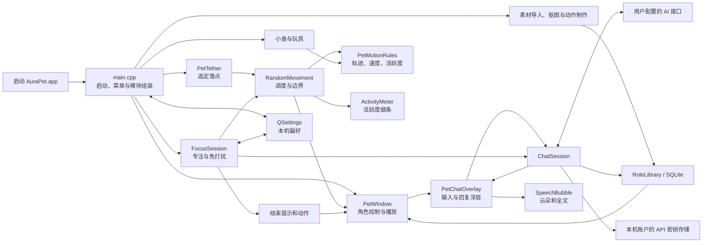

# AuraPet 项目架构说明

本文以旧版 Gif-Pet 架构为基础，补充 **AuraPet 1.0.27（macOS）** 的主要变更。包括运行时架构、60 个 C++／Objective-C++ 源码与头文件、构建入口、资源、本地数据，以及工作区里的 29 个开发脚本。

- `companion_events.*` 定义角色触发器、活动提醒和早晚问候去重。
- `focus_session.*` 持久化专注与休息计时，记录本机当天的完成轮次、时长和互动数。
- `global_hotkeys.*` 以 macOS 原生事件注册三个全局快捷键，窗口负责多屏位置和选中时的缩放。
- `role_package_dialog.cpp` 提供角色核心提示词编辑、包内容预览。原格式版本、扩展名和本机数据位置继续沿用。

## 1. 项目在哪里

| 位置 | 内容 |
| --- | --- |
| `~/Desktop/AuraPet/` | 桌面项目目录。源码平铺在根目录，双击「启动 AuraPet.app」即可运行。 |
| `outputs/AuraPet/` | Codex 工作区里的项目副本，用于编辑、构建和验证。 |
| `outputs/` | 实机预览图和项目副本。 |
| `work/` | 工作区开发材料。含历史构建、安装候选包、升级前备份、测试程序与工具链。 |

C++ 的 `.h` 文件定义类、数据结构或函数接口，`.cpp` 文件实现功能。`.mm` 是 Objective-C++，负责在 C++ 里调用苹果原生框架。根目录的构建入口是 `CMakeLists.txt`，桌面启动入口是应用包中的 `Contents/MacOS/AuraPet`。

## 2. 运行架构

项目是一个 **Qt 6 Widgets 桌面应用**。同一个进程里运行桌宠窗口、交互浮层、移动、计时和本地存储。AI 聊天和记忆整理使用用户配置的 OpenAI 兼容接口。静态图和 GIF 的抠图在 Mac 本机执行。

### 主要功能怎样串起来

| 功能 | 运行顺序 |
| --- | --- |
| 启动与切换角色 | `main.cpp` 打开数据库、读取偏好并装配模块 → 解析命令行或选择角色 → 加载动作槽或内置凯猫 → `PetWindow` 显示素材。桌面分发包配置为无参数启动时直接使用内置凯猫。 |
| 导入素材 | 文件选择或拖入 → `pet_asset` 按实际文件内容识别并解码 → 需要时进入 `import_preview` 做抠图预览 → 确认后写入角色库并在桌面显示。内容为 GIF 的 `.agif` 由 GIF 解码器直接播放。AVIF 路径支持静态图和 Alpha。 |
| 导入序列帧和制作动作 | `action_editor` 选择动作槽 → `sequence_dialog` 排列图片帧，或用 `template_dialog` 生成轻跳、摆动、呼吸 → `frame_sequence` 编码 GIF → `role_actions` 保存到角色动作槽。 |
| 自主移动 | `RandomMovement` 从窗口、屏幕和鼠标采集输入，约每 16 ms 调用一次规则 → `PetMotionRules` 选择行为并计算平滑速度 → 控制器更新窗口位置和活跃度条。 |
| 灵犀牵引 | `PetTether` 区分右键短按和长按拖动 → 画圆框、流光和落点星芒 → 松开右键后传入目标坐标 → 移动规则根据活跃度算加速、巡航和刹车。 |
| 小食与玩具 | `pet_treats` 提供道具按钮、说明和动画 → `main.cpp` 将操作接到移动规则 → 猫粮切换恢复与消耗速率，毛线球和猫薄荷即时调整同一个活跃度数值。 |
| 发送消息 | `PetChatOverlay` 接收消息 → `ChatSession` 组装当前角色的近期对话、长期记忆和提问并请求 AI → `ChatStream` 解析流式数据 → 气泡合并刷新并随行数扩展 → 完整回复保存到数据库。 |
| 记忆整理 | `role_memory.cpp` 根据消息数量、时间和长度从数据库选取旧对话 → `chat_summary` 生成请求并验证结果 → `ChatSession` 回写摘要和来源 → `memory_dialog` 提供查看、编辑和忘记操作。 |
| 桌面陪伴 | `companion_menu` 接收计时和免打扰操作 → `FocusSession` 管理状态及偏好 → `main.cpp` 同步暂停随机移动和双击发言 → 计时结束时显示提示并播放选定动作。 |

### 几个模块之间的边界

- **窗口和移动规则**。窗口负责画角色和接收事件。移动规则负责算出下一时刻的位置与活跃度，控制器负责把结果应用到窗口。
- **聊天和气泡**。聊天会话负责请求、流式回复和保存。聊天浮层管理输入焦点、刷新节奏和布局，云朵组件负责排版、屏幕位置和全文阅读。
- **素材和存档**。解码器把原始字节变成可播放素材，角色库保存素材字节和角色关系。抠图、序列帧编码和配色分析有各自的模块。
- **专注与手动操作**。专注运行、暂停和手动免打扰共用安静状态。安静时暂停自主移动与双击发言，保留手动聊天、拖动、牵引和投喂。

## 3. 每个源码文件的作用

每行写明实现文件和对应头文件的不同职责。项目把角色动作和记忆作为 `RoleLibrary` 的部分实现，因此 `role_memory.cpp` 使用 `role_library.h` 中的声明。

### 启动、窗口和移动

| 实现文件 | 作用 | 头文件及其作用 |
| --- | --- | --- |
| `main.cpp` | 程序总入口。初始化 Qt、数据库与设置，创建桌宠窗口，连接聊天、移动、计时、投喂和菜单动作。 | 程序入口为 `main()`。 |
| `pet_window.cpp` | 创建透明置顶窗口，绘制静态图和 GIF，处理缩放、拖拽、鼠标穿透、落屏和动作播放。也绘制瞄准倾斜与轻跳。 | `pet_window.h` 声明 `PetWindow`、素材与动作方法及单击、双击、导入回调。 |
| `random_movement.cpp` | 使用 Qt 定时器驱动移动。读取当前屏幕工作区和鼠标，协调聊天、免打扰、拖拽与手动目标，更新窗口位置。 | `random_movement.h` 声明移动控制器、启停接口、安静模式、定点落点及活跃度接口。 |
| `pet_motion_rules.cpp` | 实现待机、游走、探索、跟随、闪避、休息、沿边及观察。计算状态评分、冷却、转向、加速度、软边界、定点刹车与活跃度变化。 | `pet_motion_rules.h` 定义行为状态、运动空间、猫粮档位和恢复／消耗速率。 |
| `pet_tether.cpp` | 判定右键短按、长按或拖动，绘制牵引圆框、羽化箭头、流光和落点反馈，松手时交出定点目标。 | `pet_tether.h` 声明牵引手势状态、菜单回调和取消接口。 |
| `activity_meter.cpp` | 后台请求素材分析，用缓存结果定位细条并绘制槽底、填充、星芒和道具增减反馈。 | `activity_meter.h` 声明素材、进度、显示、闪光接口及外观缓存。 |
| `pet_treats.cpp` | 绘制菜单卡片和四个道具图标，显示悬停说明与装载状态，播放毛线球滚动和猫薄荷落叶。 | `pet_treats.h` 定义道具枚举、消耗与补充常量、卡片和特效窗口接口。 |

### 桌面陪伴

| 实现文件 | 作用 | 头文件及其作用 |
| --- | --- | --- |
| `focus_session.cpp` | 实现开始、暂停、继续、取消和到点完成，读写独立免打扰及提醒偏好。运行时保存绝对结束时间，暂停时保存剩余时长。 | `focus_session.h` 定义计时阶段、结束提醒类型、计时接口和状态信号。 |
| `companion_menu.cpp` | 生成右键和菜单栏的陪伴菜单，提供预设与自定义时长、暂停／继续及结束动作选择，并绘制结束文字提示。 | `companion_menu.h` 声明菜单创建入口及 `FocusNotice` 提示窗口。 |

### 素材、抠图和动作制作

| 实现文件 | 作用 | 头文件及其作用 |
| --- | --- | --- |
| `pet_asset.cpp` | 检查文件大小和图像尺寸，通过 Qt 或 libavif 解码素材。为 GIF 建立 `QMovie`，并提供 PNG 转换、原始素材保存与序列帧读取。 | `pet_asset.h` 定义 `PetAsset`，包含原始字节、首帧和可选的 GIF 播放器，并声明加载与保存接口。 |
| `pet_appearance.cpp` | 对静态图或 GIF 循环周期内可解码的帧统计可见边界，并从素材中选取代表色，供活跃度条固定贴边取色。 | `pet_appearance.h` 定义归一化边界与配色结果，声明可取消的分析函数。 |
| `background_removal.mm` | 调用 Apple Vision 获取静态图前景遮罩，将遮罩合成到 Alpha，并识别有透明像素的图。 | `background_removal.h` 声明透明度检测、静态抠图入口及结果。 |
| `gif_background.mm` | 读取 GIF 帧并逐帧抠图，稳定边缘，重新编码透明 GIF，保留帧延时和循环设置。 | `gif_background.h` 声明 GIF 抠图、结果及处理进度回调。 |
| `import_preview.cpp` | 在后台运行抠图，在对话框中对比原图与结果，支持深浅背景、动图同步预览及确认导入。 | `import_preview.h` 声明可返回确认后素材的导入预览入口。 |
| `frame_sequence.mm` | 将多张图底部居中对齐在同一画布，通过 Apple ImageIO 编码成循环 GIF。序列帧导入和动作模板共用它。 | `frame_sequence.h` 声明序列帧编码、按回调生成 GIF 和编码结果。 |
| `sequence_dialog.cpp` | 批量选择序列帧、排序、调速，后台生成可播放预览，将确认后的素材交给动作编辑器保存。 | `sequence_dialog.h` 声明序列帧导入界面的入口。 |
| `action_templates.cpp` | 根据待机首帧计算呼吸、摇摆和轻跳的逐帧变换，并调用 GIF 编码器。 | `action_templates.h` 定义模板类型、动作幅度、周期等生成参数。 |
| `template_dialog.cpp` | 提供模板选择、幅度和时长设置、动画预览，将确认后的素材交给动作编辑器保存。 | `template_dialog.h` 声明动作模板对话框入口。 |
| `action_editor.cpp` | 编辑和预览待机、开心、困倦三个动作槽，接入原样素材、序列帧和动作模板。 | `action_editor.h` 声明角色动作编辑器入口。 |

### 角色库与本地记录

| 实现文件 | 作用 | 头文件及其作用 |
| --- | --- | --- |
| `role_library.cpp` | 打开 SQLite，建基础表、迁移旧素材，保存与查询角色、角色素材、对话和主动发言。 | `role_library.h` 定义角色、对话、摘要、长期记忆与动作素材的数据结构和存取接口。 |
| `role_library_dialog.cpp` | 列出角色并标记当前角色，处理切换、自定义角色重命名和删除确认。 | `role_library_dialog.h` 声明角色库对话框及用户选择结果。 |
| `role_actions.cpp` | 管理动作数据表，按角色和槽位增删查询素材，处理待机素材的回退。 | `role_actions.h` 声明动作槽名称和角色动作加载入口。 |
| `role_memory.cpp` | 管理摘要、来源、记忆表，筛选待整理旧对话，存储摘要和记忆，处理编辑、忘记及摘要排除。 | 存储接口与数据结构声明在 `role_library.h`。 |

### AI 聊天、气泡和记忆界面

| 实现文件 | 作用 | 头文件及其作用 |
| --- | --- | --- |
| `pet_chat_overlay.cpp` | 管理悬停输入框、焦点、输入法、发送与取消、气泡布局和 40 ms 流式合并刷新。向移动控制器提供聊天占用状态。 | `pet_chat_overlay.h` 声明聊天浮层、显示信号和主动发言收起接口。 |
| `speech_bubble.cpp` | 用 `QTextLayout` 排版、用 `QPainterPath` 画清晰的云朵轮廓，选择屏幕内位置。长文可打开独立阅读窗口，继续接收流式回复。 | `speech_bubble.h` 声明气泡生命周期、消息更新、位置计算和可见行数。 |
| `chat_dialog.cpp` | 显示聊天记录、加载更早对话，提供 AI 接口配置及进入记忆窗口的入口。 | `chat_dialog.h` 声明打开指定角色聊天记录的入口。 |
| `chat_session.cpp` | 请求 OpenAI 兼容接口，组装上下文，管理双击发言、流式生命周期、终止、回退、历史保存与摘要请求。 | `chat_session.h` 声明 API 设置项、会话行为及回复开始、更新、结束信号。 |
| `chat_stream.cpp` | 解析分批到达的 SSE 事件、增量文本、结束标记和服务错误，也识别普通 JSON 回复。 | `chat_stream.h` 声明流式解析器、完成状态和错误读取接口。 |
| `chat_credentials.mm` | 按规范化的服务地址保存 API Key。旧版的 macOS 钥匙串条目只尝试静默读取。 | `chat_credentials.h` 声明读取与保存密钥的入口。 |
| `speech_text.cpp` | 在合成语音前过滤括号动作、表情和常见颜文字，保留原文位置用于同步气泡。 | `speech_text.h` 声明文本过滤入口。 |
| `chat_summary.cpp` | 生成旧对话整理请求，解析及验证摘要结构，组合可用于后续对话的摘要和记忆。 | `chat_summary.h` 声明摘要请求、结果解析和记忆上下文函数。 |
| `memory_dialog.cpp` | 显示历史摘要、长期记忆与原文来源，提供手动整理、修改及忘记入口。 | `memory_dialog.h` 声明打开角色记忆窗口的函数。 |

## 4. 构建入口和资源

| 文件或目录 | 作用 |
| --- | --- |
| `CMakeLists.txt` | 指定 C++17、Objective-C++、源码和 Qt 依赖，将凯猫 GIF 编进资源，并生成版本为 1.0.22 的 macOS 应用。 |
| `README.md` | 启动和构建步骤、目前支持的桌宠操作与功能限制。 |
| `.gitignore` | 忽略根目录的 `build/` 和 macOS 的 `.DS_Store`。 |
| `.DS_Store` | Finder 保存文件夹显示偏好时生成的系统文件。 |
| `凯猫.gif` | 内置多帧桌宠素材，CMake 通过 Qt 资源系统打包。 |
| `凯猫.avif` | 桌面目录中的静态凯猫素材，供单帧显示或手动导入。 |
| `AuraPet.icns` | macOS 应用图标。 |
| `启动 AuraPet.app/Contents/MacOS/AuraPet` | 已编译的主程序。Finder 双击应用包时由 macOS 启动它。 |
| `启动 AuraPet.app/Contents/Info.plist` | 应用包版本、标识、图标和主程序名称。 |
| `启动 AuraPet.app/Contents/Frameworks/` | Qt 框架及 AVIF 解码相关库。 |
| `启动 AuraPet.app/Contents/PlugIns/` | Qt 平台、图像格式、SQLite 及网络相关插件。 |
| `启动 AuraPet.app/Contents/Resources/` 与 `_CodeSignature/` | 应用图标等资源及应用包签名记录。 |

CMake 要求 Qt 6.2 或以上与 libavif 1.0 或以上。Qt Widgets 提供窗口和控件，Qt Sql 连接 SQLite，Qt Concurrent 执行素材分析和预览任务。macOS 目标还接入 Qt Network、Vision、CoreGraphics、CoreVideo、ImageIO 和 Security。本地抠图依赖相应的 macOS Vision 支持。

## 5. 数据保存在哪里

| 存储 | 保存内容 |
| --- | --- |
| `~/Library/Application Support/Gif-Pet/Gif-Pet/roles.sqlite3` | 自定义角色原始素材、动作槽素材、聊天历史、摘要、长期记忆和来源关系。 |
| Qt `QSettings` | 每个角色的位置与缩放、最近角色、随机移动开关、已装猫粮、专注状态、免打扰、结束动作偏好，以及 AI 服务地址和模型配置。 |
| 当前账户的私有文件 | 新保存的 AI 接口 API Key。 |
| `active-pet` | 旧版角色素材位置。迁移逻辑会检查并记录一次性导入。 |

SQLite 表的分工如下。

| 表 | 保存什么 |
| --- | --- |
| `roles` | 角色 ID、名称和原始素材字节。内置凯猫还可以从应用资源加载。 |
| `role_actions` | 每个角色在不同动作槽中的素材及名称。 |
| `chat_messages` | 角色、消息发送者、正文、时间和是否属于主动发言。 |
| `chat_archives` | 摘要正文及对应消息范围、排除状态。 |
| `role_memory` | 记忆条目、来源消息、编辑与忘记状态。 |
| `archive_memory` | 摘要和记忆条目之间的关系。 |
| `library_migrations` | 已执行的旧数据迁移标记。 |

摘要的自动检查以 **24 轮、最早可整理消息达到 7 天、累计 12,000 字符**为三个触发条件，择一达到即可进入筛选。最近 8 轮保留在近期上下文范围内，历史原文继续保存在 SQLite。生成回复与摘要所需的文本会发往所配置的 AI 服务。

## 6. 以后要改功能时，从哪里找

| 想修改的功能 | 先看哪里 |
| --- | --- |
| 加菜单入口、设置默认值、接入新模块 | `main.cpp` |
| 桌宠点按、拖拽、缩放或播放方式 | `pet_window.cpp` |
| 自由移动路线、速度和恢复／消耗参数 | `pet_motion_rules.h` 与 `pet_motion_rules.cpp` |
| 聊天、免打扰对移动的影响 | `main.cpp` 与 `random_movement.cpp` |
| 右键拖动特效和落点星芒 | `pet_tether.cpp` |
| 云朵尺寸、文字排版、全文按钮 | `speech_bubble.cpp` |
| 输入框焦点、双击发言衔接、气泡何时收起 | `pet_chat_overlay.cpp` 与 `main.cpp` |
| 模型请求、对话上下文与主动发言 | `chat_session.cpp` |
| 投喂消耗与恢复数值、道具卡片和提示 | `pet_treats.h`、`pet_treats.cpp` 与 `pet_motion_rules.h` |
| 专注时长选项、结束提示与行为 | `companion_menu.cpp`、`focus_session.cpp` 与 `main.cpp` |
| 角色素材、动作存档或记忆来源 | `role_library.cpp`、`role_actions.cpp` 与 `role_memory.cpp` |

## 7. 工作区开发脚本

这些文件位于 Codex 工作区的 `work/`。版本安装脚本使用各自版本的候选应用、源码清单和备份目录。它们检查现有桌面版与备份是否匹配，正常退出旧版，替换并启动应用，核对版本、签名和数据库。支持回滚的阶段按脚本内部的错误处理恢复旧应用。桌面日常启动使用「启动 AuraPet.app」。

### 18 个历史版本安装脚本

| 脚本 | 目标版本及用途 |
| --- | --- |
| `work/install-action-slots.sh` | 1.0.5。安装角色多动作槽、编辑器和动作播放。 |
| `work/install-sequence.sh` | 1.0.6。安装序列帧导入、预览与 GIF 编码。 |
| `work/install-action-templates.sh` | 1.0.7。安装轻跳、摇摆、呼吸动作模板。 |
| `work/install-random-movement.sh` | 1.0.8。安装第一版随机桌面移动。 |
| `work/install-desktop-chat.sh` | 1.0.9。安装桌宠输入框、回复云朵、双击发言及相关数据迁移。 |
| `work/install-hover-chat.sh` | 1.0.10。安装悬停输入框与单击聚焦交互。 |
| `work/install-growing-chat.sh` | 1.0.11。安装随输入内容加宽、换行增高的输入框。 |
| `work/install-minimal-chat.sh` | 1.0.12。安装简化后的聊天输入框。 |
| `work/install-lively-movement.sh` | 1.0.13。安装平滑运动和多状态自主行为。 |
| `work/install-activity-meter.sh` | 1.0.14。安装独立活跃度竖条。 |
| `work/install-adaptive-meter.sh` | 1.0.15。安装随素材尺寸调整、随输入框显隐的活跃度条。 |
| `work/install-fixed-meter.sh` | 1.0.16。安装根据透明轮廓固定贴边和按素材取色的细条。 |
| `work/install-tether.sh` | 1.0.17。安装右键灵犀牵引、落点特效和定点移动。 |
| `work/install-activity-tether.sh` | 1.0.18。安装由活跃度驱动速度和刹车的定点移动。 |
| `work/install-pet-treats.sh` | 1.0.19。安装小食与玩具、道具动画及活跃度联动。 |
| `work/install-treat-descriptions.sh` | 1.0.20。安装道具悬停时的效果和用法说明。 |
| `work/install-speech-bubble.sh` | 1.0.21。安装自适应云朵和本条全文阅读窗口。 |
| `work/install-desktop-companion.sh` | 1.0.22。安装专注计时、免打扰和结束提醒。 |

### 11 个构建、探针与验证脚本

| 脚本 | 作用 |
| --- | --- |
| `work/desktop-chat-check/digest-role-db.py` | 只读计算数据库内容摘要。对比新增主动发言列之前和之后的原有数据。 |
| `work/pet-treats-check/build.py` | 复用正式构建的对象文件和编译参数，构建独立测试身份的道具菜单验证程序。 |
| `work/treat-descriptions-check/build.py` | 构建验证四个道具悬停说明与点击行为的 Qt 测试程序。 |
| `work/speech-bubble-check/build.py` | 将气泡验证入口链接到正式构建的模块，检查窗口布局、全文和模拟流式回复。 |
| `work/desktop-companion-check/build.py` | 构建独立测试身份的桌面陪伴验证程序，检查专注菜单、恢复和实际应用行为。 |
| `work/gif-browser-check/check.mjs` | 用本机 Chrome 验证素材解码、是否随时间换帧及浅深底色效果。配套页面为 `work/gif-browser-check/theme.html`。 |
| `work/gif-cutout-check/codec_probe.swift` | 生成不同帧延时的 GIF 探针素材，用于检查 ImageIO 的编码和时序。 |
| `work/gif-cutout-check/fixture.swift` | 生成不同循环模式、帧数和延时的带背景 GIF，用作动图抠图测试输入。 |
| `work/movement-check/check-installed.swift` | 采样桌面已安装进程的窗口，检查早期随机移动时窗口位置变化、尺寸稳定。 |
| `work/lively-motion-check/check-installed.swift` | 采样桌面已安装窗口，验证新版自主移动实际改变 macOS 窗口位置。 |
| `work/verify-pet-movement.cjs` | 用 Playwright 验证浏览器中的移动方案演示，覆盖固定路线、随机游走、混合模式及禁入区。配套页面为 `work/gif-pet-movement-check.html`，用于讨论路线方案。 |

工作区还保留了编译型验证程序。它们通过原生窗口、测试素材、独立数据库或本机模拟 AI 接口检查功能。

| 测试源文件 | 验证范围 |
| --- | --- |
| `work/verify/verify.cpp` | 基础素材读取、桌宠显示及截图。 |
| `work/cutout-check/verify.cpp`、`work/gif-cutout-check/verify.cpp` | 静态和 GIF 抠图、预览、播放与时序。 |
| `work/icon-agif-test/verify.cpp` | 启动入口、内置凯猫、应用图标相关流程与 `.agif` 播放。 |
| `work/role-library-check/verify.cpp`、`work/action-check/verify.cpp` | 角色库操作、动作素材和角色与动作对应关系。 |
| `work/sequence-check/verify.cpp`、`work/template-check/verify.cpp` | 序列帧导入和动作模板的生成、播放与保存。 |
| `work/chat-check/verify.cpp`、`work/desktop-chat-check/verify.cpp` | 聊天接口、流式输出、对话保存和早期桌面聊天入口。 |
| `work/hover-chat-check/verify.cpp`、`work/growing-chat-check/verify.cpp` | 悬停、焦点、输入框宽高变化和换行。 |
| `work/memory-check/verify.cpp`、`work/desktop-chat-check/memory.cpp`、`work/hover-chat-check/memory.cpp`、`work/growing-chat-check/memory.cpp`、`work/adaptive-meter-check/memory.cpp` | 各开发阶段保留的摘要、长期记忆、来源和编辑验证。 |
| `work/movement-check/verify.cpp`、`work/lively-motion-check/verify.cpp` | 移动视窗边界、暂停、行为分布和平滑、定点与活跃度关系。 |
| `work/activity-meter-check/verify.cpp`、`work/adaptive-meter-check/verify.cpp`、`work/adaptive-meter-check/geometry.cpp`、`work/fixed-meter-check/verify.cpp` | 活跃度条显示、位置、尺寸、GIF 固定边界和素材取色。 |
| `work/tether-check/verify.mm` | 原生短按右键、牵引、落点、Esc 取消和边缘约束。 |
| `work/pet-treats-check/verify.mm`、`work/treat-descriptions-check/verify.mm` | 道具卡片、说明、猫粮切换、活跃度变化和道具动效。 |
| `work/speech-bubble-check/verify.mm` | 回复增长、屏幕边缘、全文窗口、流式更新与历史一致性。 |
| `work/desktop-companion-check/verify.mm` | 专注计时、免打扰、暂停、休眠后的时间校准及结束提醒。 |

测试目录里的 `CMakeLists.txt` 或 `build.py` 为对应验证程序设置编译与链接入口。部分测试目录里的 `main.cpp` 是脚本根据正式入口生成的隔离版。`pre-*` 是升级前快照，`*-pack` 是候选应用包，`*-build` 和 `build/` 存放构建产物，`toolchain/` 提供本地构建工具与第三方依赖。
