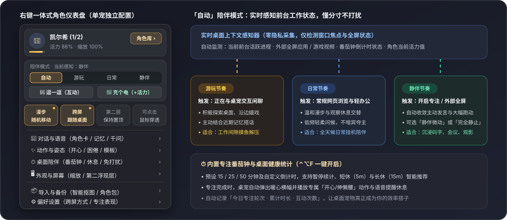
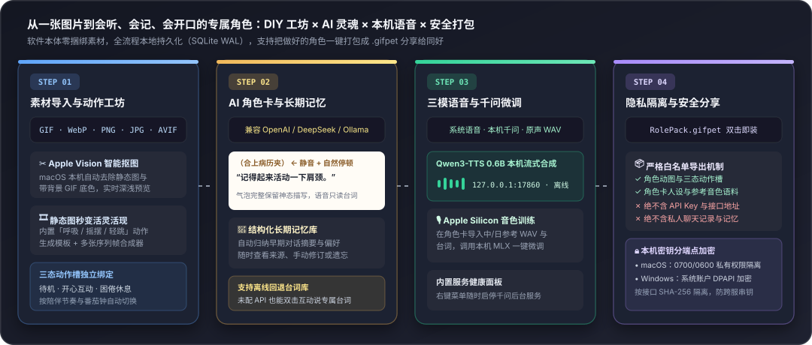

<div align="center">

# AuraPet

**懂分寸、不挡视线、会听会记的跨平台开源 AI 桌面伙伴**

[](https://github.com/StewardAndrecher/AuraPet/releases/latest)
[%20%7C%20Windows%2010%2F11%20x64-3B82F6?style=flat-square)](docs/安装文档.md)
[](docs/架构说明.md)
[](#23-diy-动作工坊--ai-旁白停顿--本机千问语音--安全分享)
[](LICENSE)

[**🎯 它有什么用？**](#-aurapet-能用来做什么四大核心用处) · [**✨ 核心功能图解**](#-核心功能全景图解) · [**🎮 交互手势与快捷键**](#-30-秒上手交互手势与全局快捷键) · [**🚀 懒人一键部署**](#-下载与-3-步懒人一键部署) · [**📖 使用文档**](docs/使用文档.md) · [**📦 安装文档**](docs/安装文档.md) · [**🏗 架构说明**](docs/架构说明.md)

</div>

---

<table>
<tr>
<td width="30%" align="center" valign="middle">
  <picture>
    <source srcset="docs/demo/kaltsit-demo.webp" type="image/webp" />
    
  </picture>
  <br />
  <sub><b>实机运行录屏</b>（WebP 极速加载）<br />演示素材「凯尔希·思衡托」已获原作者授权（B 站：<a href="https://b23.tv/WZEZOLH">星天雷_Star</a>），仅作为独立可选 <code>.gifpet</code> 角色包分发，<b>软件本体零内置素材</b>。</sub>
</td>
<td width="70%" valign="middle">

### 为什么做 AuraPet？解决传统桌宠的四大痛点

- **🪟 不挡打字，也不被旧窗口淹没**：独创 **「活跃窗口下第二浮现层」**——永远让位于你正在敲字的前台焦点窗口，又始终浮在所有后台旧窗口之上。
- **🧭 懂分寸的智能陪伴节奏**：「自动」模式实时感知前台焦点与全屏状态，在 **游玩 / 日常 / 静伴** 间无感切换，内置 **专注番茄钟** 与休息提醒。
- **💬 像真人一样说话与记忆**：支持任意 OpenAI 兼容流式对话；**自动跳过 `（神态动作描写）` 不发声并按字数插入自然阅读停顿**；旧对话自动提炼为可编辑的长期记忆。
- **🎨 纯净零捆绑 & 自由 DIY 生态**：主程序仅约 32 MB，拖入图片/动图即可生成角色（macOS 支持 **Apple Vision 本机抠图** 与 **MLX 音色微调**），支持多宠同屏与 `.gifpet` 白名单安全分享。

</td>
</tr>
</table>

<p align="center">
  
</p>

---

## 🎯 AuraPet 能用来做什么？（四大核心用处）

<table>
<tr>
<td width="50%" valign="top">

### 🧑‍💻 1. 编码、写作与深度学习时的「无感专注搭子」
开着 IDE、论文或全屏网课时，传统置顶桌宠总挡住代码行或按钮；关掉置顶又瞬间被十几个参考窗口压在最底下。
- **活跃窗口下第二层**：桌宠自动驻留在「当前焦点窗口」与「后台旧窗口群」之间，视线零干扰、屏幕边缘常陪伴。
- **专注番茄钟闭环**：快捷键 `⌃⌥F` / `Ctrl+Alt+F` 一键开启 15 / 25 / 50 分钟专注计时，期间自动切入「静伴微动」或「完全静止」，到点温柔提醒起身休息。

</td>
<td width="50%" valign="top">

### 💬 2. 会听、会记、懂语气停顿的「桌面 AI 角色伙伴」
不只是机械复读的气泡框，而是能记住你习惯、在桌面长期生活的角色：
- **单击聊天 / 双击搭话**：接入 OpenAI / DeepSeek / Ollama / 本地大模型即可流式对话；未配 API 时自动回退本地台词与原声语料。
- **括号旁白静音停顿**：遇到 `（合上病历夹，抬眼看向你）` 这类描写，气泡完整保留文字画面感，语音自动静音并插入自然停顿后再读台词。
- **可掌控的长期记忆**：自动从历史聊天提炼偏好与事件摘要，随时查看来源、手动修改或一键遗忘。

</td>
</tr>
<tr>
<td width="50%" valign="top">

### 🎙️ 3. 本机离线流式配音与「专属角色音色微调」
无需将聊天文本上传第三方配音平台，在本地就能获得低延迟角色语音：
- **三套发音无缝切换**：零配置 **系统内置语音**、随包播放 **角色原声 WAV**，或一键部署本机 **Qwen3-TTS 0.6B 流式语音服务**（`127.0.0.1:17860`）。
- **Apple Silicon 音色训练**：在角色卡导入中文/日文参考 WAV 与台词转写，即可调用本机 **MLX** 微调出专属角色音色。

</td>
<td width="50%" valign="top">

### 🎨 4. 零门槛 DIY 专属桌宠与「同好角色包工坊」
把任何你喜欢的立绘、表情包、像素小人或原创 OC 变成桌面活物：
- **拖入即用 + 智能去底**：支持 `GIF / .agif / WebP / PNG / JPEG / AVIF`；macOS 内置 **Apple Vision 前景抠图**（支持静态图与带背景 GIF 逐帧稳定去底）。
- **静态图秒变动画**：内置 **呼吸 / 摇摆 / 轻跳** 动作模板与序列帧合成器，可为「待机 / 开心 / 困倦」三槽分别绑定动作。
- **多宠同屏 & `.gifpet` 分享**：多角色同屏各自独立记忆与活力；一键白名单导出 `.gifpet`，双击即装、绝不泄漏私钥与隐私。

</td>
</tr>
</table>

---

## ✨ 核心功能全景图解

### 2.1 右键一体式角色仪表盘 & 四档智能陪伴模式

右键短按任意桌宠，即可呼出集成了**状态横幅、陪伴节奏切换、互动喂养与四宫格快捷磁贴**的一体式仪表盘；开启多宠同屏时，**每一只桌宠的坐标、缩放、陪伴档位、活力值、人设与对话记忆均完全独立保存**。

<p align="center">
  
</p>

- **四档陪伴模式（自动 / 游玩 / 日常 / 静伴）**：「自动」模式会实时检测当前前台活跃应用与外部全屏状态——摸鱼互动时活泼回应，轻度办公时适度漫步，写代码或全屏会议时自动收敛为低频「静伴」。
- **活力细条与即时互动**：桌宠边缘贴合素材代表色绘制轻巧活力条；点击 **「🧶 逗一逗」** 触发开心互动反馈，点击 **「🌿 充个电」** 即时恢复角色活力与移动积极性。

---

### 2.2 窗口层级与跨屏黑科技：第二浮现层 & 跨虚拟桌面随行

针对桌面重度多任务与多虚拟桌面（macOS Spaces）用户，AuraPet 在窗口管理底层做了深度定制：

<p align="center">
  
</p>

- **跨桌面方位感知随行（macOS Spaces）**：
  - 滑动切换桌面时，桌宠会先随原桌面保持相对位置平滑滑出（绝不突兀悬停闪烁），随后**严格按照新旧桌面的左右相邻关系**，从相邻屏幕边缘以**抛物线轻跃**或**平滑步行**进入新桌面的较近端落点区（偏好设置可选 **组合随机 / 仅跳入 / 仅步行**）。
  - **气泡随行续写**：切屏瞬间若桌宠正在流式说话，对话气泡会自动清理前屏残影并无缝跟随到新桌面继续输出，呈现“一边说话一边追过来”的鲜活陪伴感。
- **灵犀牵引（右键按住拖放）**：在桌宠身上**按住右键不放并拖动鼠标**，会展开金色流光瞄准环与星芒落点；松手后桌宠将根据当前活力值加速奔向目标点并自然急停刹车（底层已针对多桌面手势做防误滑隔离）。

---

### 2.3 DIY 动作工坊 × AI 旁白停顿 × 本机千问语音 × 安全分享

<p align="center">
  
</p>

---

### 2.4 跨平台能力速览（macOS vs Windows）

| 功能模块 | macOS 14.0+ (Apple Silicon) | Windows 10 / 11 (x64) |
| --- | :---: | :---: |
| 多宠同屏独立养成、无背景网格角色库、`.gifpet` 导入导出 | ✅ | ✅ |
| 四档智能陪伴（自动感知焦点/全屏）、逗一逗/充个电、灵犀牵引 | ✅ | ✅ |
| 专注番茄钟（15/25/50m/自定义）、免打扰、全局快捷键 | ✅ (`⌃⌥A/F/D`) | ✅ (`Ctrl+Alt+A/F/D`) |
| OpenAI 兼容流式对话、括号动作旁白静音停顿、结构化长期记忆 | ✅ | ✅ |
| 系统内置语音朗读、角色原声 WAV 语料播放、本机 Qwen3-TTS 流式接入 | ✅ | ✅ |
| API Key 本机账户级加密隔离存储 | ✅ (`0700/0600` 权限隔离) | ✅ (Windows `DPAPI` 加密) |
| 活跃窗口下第二浮现层、跨虚拟桌面（Spaces）方位感知跃入与气泡随行 | ✅ 原生支持 | 保持置顶 / 普通层级切换 |
| Apple Vision 静态图/动图智能抠图、序列帧与动作模板、MLX 本地音色微调 | ✅ 原生硬件加速 | 可直接导入现成透明动图 / `.gifpet` 包 |

---

## 🎮 30 秒上手：交互手势与全局快捷键

| 鼠标 / 拖拽操作 | 触发效果 |
| --- | --- |
| **左键单击桌宠** | 呼出底部悬浮输入框，与当前角色流式文字/语音对话（`Enter` 发送，`Shift+Enter` 换行，`Esc` 收起或打断朗读） |
| **左键双击桌宠** | 触发一次角色主动搭话（优先结合近期记忆调用 AI，未配接口时自动播放本地专属台词或原声 WAV） |
| **左键按住拖动** | 自由摆放当前桌宠在屏幕上的位置（多显示器坐标自动记忆） |
| **右键短按桌宠** | 打开一体式角色仪表盘（切换陪伴模式、快捷磁贴、角色库、番茄钟、AI 与语音设置） |
| **右键按住拖动并松开** | 发动 **「灵犀牵引」**：画出星芒落点，指引桌宠按当前活力奔向指定屏幕位置 |
| **直接拖入文件到桌宠** | 快速导入 `GIF / WebP / PNG / JPEG / AVIF` 素材或一键安装 `.gifpet` 角色包 |

**全局快捷键**：显示/隐藏全部桌宠 `⌃⌥A`（Win: `Ctrl+Alt+A`） · 一键开启 25 分钟专注 `⌃⌥F`（Win: `Ctrl+Alt+F`） · 切换免打扰 `⌃⌥D`（Win: `Ctrl+Alt+D`）

---

## 🚀 下载与 3 步懒人一键部署

前往 **[GitHub Releases 最新版页面](https://github.com/StewardAndrecher/AuraPet/releases/latest)** 按需选择下载：

| 发行文件 | 推荐人群 | 体积 | 说明 |
| --- | --- | :---: | --- |
| **`AuraPet-<版本>-macOS-arm64-Light.zip`** | **大多数 Mac 用户首选** | ~32 MB | 极简主程序 + 系统语音 + 原声播放 + 一键安装脚本 |
| **`AuraPet-<版本>-macOS-arm64-Qwen-Offline.zip`** | **想要离线高拟真 AI 配音的 Mac 用户** | ~1.25 GB | 内置已校验 `Qwen3-TTS 0.6B` GGUF 权重，免翻墙免二次下载大模型 |
| **`AuraPet-<版本>-Windows-x64-Light.zip`** | **Windows 10 / 11 用户** | ~35 MB | Windows 主程序 + 免管理员一键安装与 `.gifpet` 文件关联脚本 |
| **`AuraPet-<版本>-Kaltsit-RolePack.gifpet`** | **想直接体验完整演示角色的玩家（可选）** | ~50 MB | 授权凯尔希·思衡托角色包（含动图、动作槽、角色卡人设与中日参考音色） |

### 第 1 步：一键安装主程序
- **macOS（Apple Silicon，macOS 14.0+）**：解压后双击 **`安装 AuraPet.command`** → 按弹窗选择「一键安装 AuraPet」（或全量包中的「同时安装千问」），脚本会自动解除下载隔离属性、完成签名校验、安装至 `~/Applications/AuraPet.app` 并启动。
- **Windows（Windows 10 / 11 x64）**：解压后双击 **`安装 AuraPet.bat`** → 输入 `1`（仅装桌宠）或 `2`（同时配置千问目录）回车，自动免管理员安装到 `%LOCALAPPDATA%\AuraPet` 并创建桌面快捷方式。

### 第 2 步：导入第一个角色
首次启动会弹出导入引导：直接**双击**或**拖入**可选下载的 `Kaltsit-RolePack.gifpet`，或拖入任意你喜欢的透明 GIF / PNG 图片即可召唤桌宠。

### 第 3 步（可选）：接入 AI 对话接口
右键桌宠 → **「对话与语音」→「聊天记录与记忆…」→「AI 接口…」**，填入任意 OpenAI 兼容地址（如 DeepSeek、OpenAI、SiliconFlow 或本地 Ollama `http://127.0.0.1:11434/v1`）、模型名与 API Key，保存后单击桌宠即可开聊！

<details>
<summary><b>🛠️ 我是开发者：查看从源码编译与本地打包命令（CMake + Qt 6）</b></summary>

#### macOS（Homebrew + Ninja）
```bash
brew install cmake ninja qt@6 libavif libarchive
cmake -S . -B build -G Ninja \
  -DCMAKE_BUILD_TYPE=Release \
  -DCMAKE_PREFIX_PATH="$(brew --prefix qt@6);$(brew --prefix libavif);$(brew --prefix libarchive)"
cmake --build build --parallel
ctest --test-dir build --output-on-failure
open build/AuraPet.app
```

#### Windows（PowerShell + Visual Studio 2022 + vcpkg）
```powershell
vcpkg install libavif:x64-windows libarchive:x64-windows
cmake -S . -B build -G "Visual Studio 17 2022" -A x64 `
  -DCMAKE_TOOLCHAIN_FILE="$env:VCPKG_INSTALLATION_ROOT/scripts/buildsystems/vcpkg.cmake" `
  -DCMAKE_PREFIX_PATH="C:/Qt/6.7.3/msvc2019_64"
cmake --build build --config Release --parallel
ctest --test-dir build -C Release --output-on-failure
```

完整打包脚本与排障说明详见 **[docs/安装文档.md](docs/安装文档.md#6-开发者从源码编译与本地打包)**。
</details>

---

## 🔒 隐私与 API 密钥安全边界

AuraPet 将用户隐私与密钥隔离作为底层硬性约束：
- **API Key 本机按端点加密隔离**：密钥仅保存在本机当前系统账户私有目录（macOS 为 `~/Library/Application Support/AuraPet/chat-credentials/<接口 SHA-256>` `0600` 权限；Windows 采用 `CryptProtectData` DPAPI 绑定账户加密），切换接口地址不会把旧 Key 发往新服务器。
- **角色包分享零隐私泄漏**：导出 `.gifpet` 采用严格字段白名单，仅打包图像素材、动作槽、角色卡提示词与参考音色，**绝不包含 API Key、服务地址、聊天历史或长期记忆**。
- **本地优先存储**：所有角色素材、聊天记录与长期记忆均存储在你本机的 SQLite 数据库中，除你主动配置的 AI 对话接口外无任何遥测上报。

---

## 📚 文档导航与开源许可

- **[安装与部署指南（docs/安装文档.md）](docs/安装文档.md)**：四类发行产物详解、macOS / Windows 懒人部署、千问语音服务排障与完整卸载指南。
- **[功能使用手册（docs/使用文档.md）](docs/使用文档.md)**：手势详解、多宠管理、四档陪伴与番茄钟定制、AI 旁白停顿、长期记忆与音色微调教程。
- **[系统架构说明（docs/架构说明.md）](docs/架构说明.md)**：多宠实例调度、跨平台模块划分、窗口第二浮现层与跨屏算法、SQLite 表结构及二次开发速查。
- **[第三方组件与开源许可（distribution/第三方组件.md）](distribution/第三方组件.md)**：本项目源码基于 **[MIT License](LICENSE)** 开源；发行包附带组件的许可证说明见该文档。
