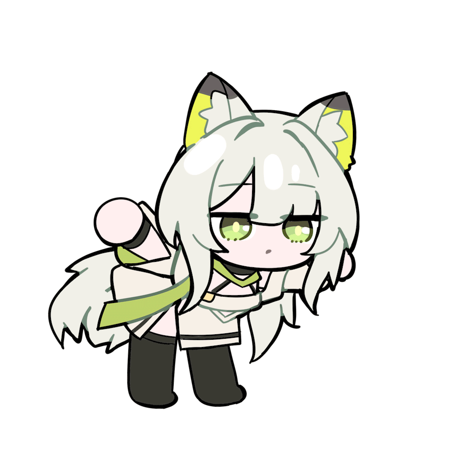
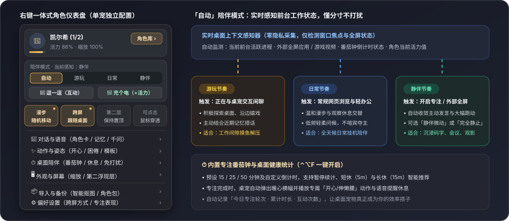
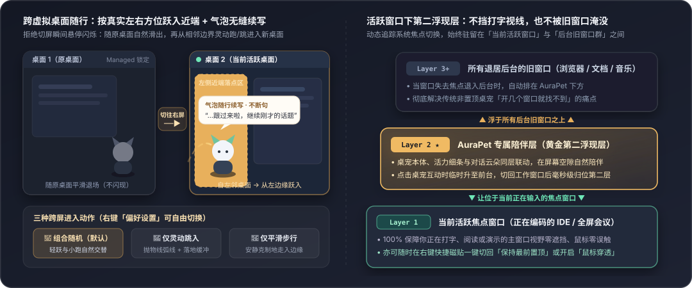
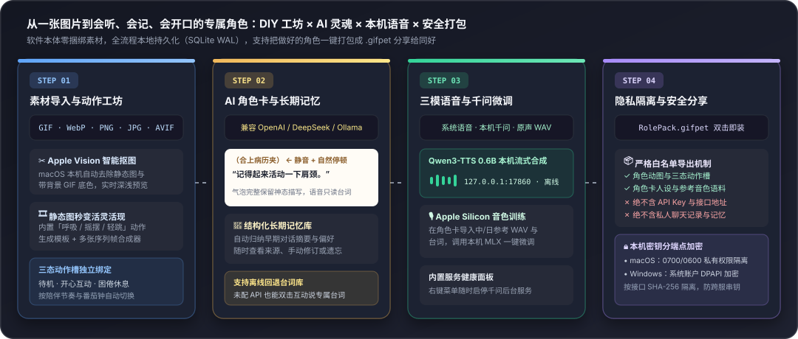

# AuraPet 功能使用手册

> **快速导航**：[返回项目首页](../README.md) · [安装与部署指南](安装文档.md) · [系统架构说明](架构说明.md)

AuraPet 是一款轻量、懂分寸、可高度自定义的跨平台 AI 桌面伙伴，支持**多宠同屏独立养成、四档智能陪伴模式、活跃窗口下第二浮现层、跨虚拟桌面方向感知随行、专注番茄钟、流式 AI 对话与动作旁白自然停顿、结构化长期记忆**，以及**系统语音 / 本机千问（Qwen3-TTS）流式配音**。

  <picture>
    <source srcset="demo/kaltsit-demo.webp" type="image/webp" />
    
  </picture>

---

## 1. 基础交互与全局快捷键

| 操作手势 | 触发效果 |
| --- | --- |
| **左键单击桌宠** | 弹出底部悬浮输入框，与当前角色开始流式文字/语音对话（`Enter` 发送，`Shift + Enter` 换行，`Esc` 关闭输入框或立即停止当前语音朗读） |
| **左键双击桌宠** | 触发一次主动搭话（优先调用 AI 结合近期记忆生成回复；未配置 AI 接口时自动回退到本地预设台词或角色原声 WAV） |
| **左键按住拖动** | 自由移动当前桌宠在屏幕上的位置（支持多显示器坐标独立记忆） |
| **右键短按桌宠** | 打开**一体式角色仪表盘**（含角色状态横幅、四档陪伴模式、互动按钮、四宫格快捷磁贴与分类功能菜单） |
| **右键按住拖动并松开** | 发动 **「灵犀牵引」**：展开流光圆环与星芒落点，桌宠会按当前活力与陪伴节奏加速奔向指定目标并自然刹车 |
| **拖拽文件到桌宠** | 快速导入 `PNG / JPEG / GIF / .agif / WebP / 静态 AVIF` 素材，或一键安装 `.gifpet` 角色包 |

### 全局快捷键

| 功能 | macOS | Windows |
| --- | --- | --- |
| 显示 / 隐藏全部桌宠 | `⌃ ⌥ A` | `Ctrl + Alt + A` |
| 一键开始 25 分钟专注计时 | `⌃ ⌥ F` | `Ctrl + Alt + F` |
| 切换免打扰模式 | `⌃ ⌥ D` | `Ctrl + Alt + D` |

---

## 2. 一体式右键仪表盘、陪伴模式与活力系统

右键短按桌宠即可看到顶部的一体式控制区：

  

### 四档陪伴模式
- **自动（默认推荐 · 智能感知）**：实时监测前台活跃焦点窗口与外部全屏应用状态：
  - 当你正点击或与 AuraPet 互动时，自动切入活泼的 **「游玩」** 节奏；
  - 浏览网页或日常轻度办公时，保持适度巡游的 **「日常」** 节奏；
  - 检测到正在专注编码、写作或处于全屏应用/会议时，自动收敛为 **「静伴」**。
- **游玩**：高频灵动漫步与主动冒泡互动，适合闲暇摸鱼与陪伴玩耍。
- **日常**：适度桌面巡游与偶尔问候提醒，轻松陪伴不喧宾夺主。
- **静伴**：仅保留极低频微动、降低主动打扰，安静守在桌面角落。

### 快捷互动与四宫格磁贴
- **🧶 逗一逗**：立即触发角色开心互动动画与即时反馈。
- **🌿 充个电**：快速补充角色活力值（对应桌宠侧边的贴边彩色活力细条）。
- **四宫格快捷开关**：一键切换当前角色的 **「随机移动」**、**「跟随桌面」**、**「保持置顶 / 第二层」** 与 **「鼠标穿透」**（开启穿透后鼠标可直接点穿桌宠操作下方内容，可通过菜单栏图标或角色库恢复）。

---

## 3. 窗口层级与跨虚拟桌面（Spaces）随行

  

### 活跃窗口下第二浮现层（macOS）
在右键快捷磁贴中取消「保持置顶」（切换为 **「第二层」**）时：
- **不挡当前工作**：桌宠会自动让位于你当前正在输入或阅读的**最前焦点窗口**（Layer 1），绝不遮挡光标和代码。
- **不被旧窗口掩盖**：所有失去焦点退居后台的旧窗口（Layer 3+）都会排在桌宠下方，桌宠始终在屏幕空隙中清晰可见。

### 跨虚拟桌面方向感知进入（macOS Spaces）
开启 **「跟随桌面」** 后，在多个虚拟桌面之间左右滑动切屏时：
- **原位顺滑退场**：桌宠会随原桌面保持相对坐标自然滑出，不会在切屏中途突兀悬停或闪烁消失。
- **符合左右方位的近端进入**：若你从左侧桌面切往右侧桌面，桌宠会从**左边缘**进入新桌面的左侧近端区域（反之从右边缘进入右侧近端）。
- **三种跨屏动作可选**：在右键 → **「偏好设置」** 中，可将跨桌面进入方式设为 **「组合随机（轻跃+步行）」**、**「仅灵动跳入」** 或 **「仅平滑步行」**。
- **气泡随行续写**：切屏时若桌宠正在流式说话，气泡会自动清理前屏旧残影并跟随桌宠到新桌面继续把话说完。

---

## 4. 角色库、多宠同屏与 DIY 动作工坊

右键桌宠 → 点击顶部 **「角色库 ›」** 即可打开无背景网格角色库：

- **多宠同屏独立运行**：支持同时在桌面召唤多只桌宠，每只桌宠的位置、缩放比例、陪伴档位、活力值、三态动作槽、角色卡人设与聊天记忆均完全独立。
- **自定义三态动作槽与模板**：右键 → **「动作与姿态」** 可为角色分别绑定 **「待机 / 开心 / 困倦」** 三个动作槽：
  - 支持直接导入现成透明动图；
  - 支持多张静态序列帧底部对齐合成循环 GIF；
  - 支持使用静态立绘一键生成 **「呼吸 / 摇摆 / 轻跳」** 动态模板（可调幅度与周期）。
- **Apple Vision 本机智能抠图（macOS）**：导入普通带背景图片或 GIF 时，可在预览窗实时对比深浅底色并一键完成前景抠图。
- **导入 / 导出 `.gifpet` 角色包**：右键 → **「导入与备份」** 可将角色动图、动作槽、角色卡提示词与参考音色打包为 `.gifpet` 文件分享给同好。

---

## 5. 专注番茄钟与免打扰

右键 → **「桌面陪伴」→「开始专注」**（或使用全局快捷键 `⌃⌥F` / `Ctrl+Alt+F`）：

- 内置 **15 / 25 / 50 分钟** 常用档位以及自定义专注时长，支持中途暂停、继续与本机当日专注轮次统计。
- 专注到点自动弹出休息提示并联动角色开心/休息动作。
- **专注期间表现可定制**：右键 → **「偏好设置」** 中可自由选择专注倒计时期间桌宠保持 **「静伴微动」** 或 **「完全静止」**。

---

## 6. AI 流式对话、动作旁白停顿、长期记忆与语音微调

  

### 配置 OpenAI 兼容接口
1. 右键桌宠 → **「对话与语音」→「聊天记录与记忆…」→「AI 接口…」**。
2. 填入任意 OpenAI 兼容服务地址（Base URL，例如 DeepSeek、OpenAI、SiliconFlow 或本地 Ollama `http://127.0.0.1:11434/v1`）、模型名称与 API Key 并保存。
3. 左键单击桌宠即可开启 SSE 流式云朵气泡对话；回复过长时支持点击展开独立全文阅读窗。

### 括号动作旁白静音与自然停顿
- 当角色回复包含中文或英文括号包裹的神态动作描写（如 `（放下手中的笔，抬眼看向你）博士，该休息了。`）时：
  - **气泡端**：完整保留括号内的动作与神态文字，维持角色扮演沉浸感；
  - **语音端**：自动跳过括号内容不发声，并**依据括号内字数智能插入自然阅读停顿**，让看字与听声的节奏浑然一体。

### 结构化长期记忆
- 当角色累积的历史对话达到自动整理阈值（或你在 **「聊天记录与记忆…」→「角色记忆」** 中手动点击整理）时，AuraPet 会将较早对话提炼为结构化摘要与长期记忆条目。
- 你可以随时查看每条记忆对应的原始对话来源、手动修订措辞，或点击「忘记」彻底移除某条记忆。

### 三模语音朗读与本机音色微调
右键 → **「对话与语音」→「回复语音…」**：
- **系统内置语音**：勾选「朗读桌宠发言」与「使用系统发音」，零依赖直接调用 macOS / Windows 系统 TTS。
- **本机千问（Qwen3-TTS 0.6B）离线流式朗读**：取消勾选「使用系统发音」，默认连接本机 `http://127.0.0.1:17860/v1/audio/speech`。可通过右键 → **「对话与语音」→「本机千问语音服务…」** 查看健康状态或一键启停后台服务。
- **角色原声 WAV 回放**：若导入的 `.gifpet` 角色包附带角色原声语料（如可选凯尔希角色包），离线或回退发言时可直接播放原声 WAV 并同步气泡字幕。
- **Apple Silicon 本机音色训练（macOS）**：右键 → **「对话与语音」→「角色卡与音色…」**，导入中文/日文 WAV 参考录音与对应台词后，点击「一键训练音色」即可调用本机 MLX 微调专属角色音色。

---

## 7. 隐私与 API 密钥安全

AuraPet 将隐私安全作为底层硬性边界设计：

- **API Key 按接口端点加密隔离存储**：
  - **macOS**：`~/Library/Application Support/AuraPet/chat-credentials/<规范化接口地址 SHA-256>`（目录权限 `0700`，文件权限 `0600`，仅当前登录账户可读写）。
  - **Windows**：`%LOCALAPPDATA%\AuraPet\chat-credentials\<规范化接口地址 SHA-256>`（采用 Windows DPAPI `CryptProtectData` 绑定当前系统账户加密）。
- **分享 `.gifpet` 零隐私泄漏**：角色包导出采用严格字段白名单，仅写入图像素材、动作槽、角色卡人设与参考音色，**绝不包含任何 API Key、接口地址、私人聊天记录或长期记忆**。
