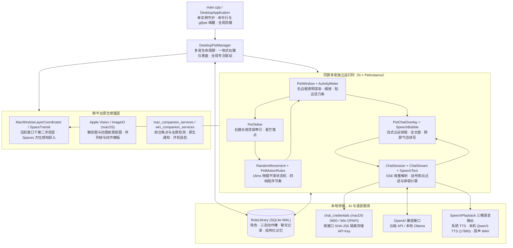

# AuraPet 系统架构说明

> **快速导航**：[返回项目首页](../README.md) · [功能使用手册](使用文档.md) · [安装与部署指南](安装文档.md)

本文档介绍 **AuraPet（C++17 / Objective-C++17 / Qt 6）** 的整体运行时架构、多宠实例调度机制、窗口层级与跨桌面算法、AI 与流式语音链路、本地 SQLite 数据结构，以及二次开发时的源码速查索引。

---

## 1. 整体运行架构概览

AuraPet 是一个跨平台原生桌面应用（支持 **macOS 14.0+ Apple Silicon** 与 **Windows 10/11 x64**）。主进程基于 **Qt 6（Widgets / Sql / Concurrent / Network）** 构建，内部通过 `DesktopPetManager` 统一编排任意数量的同屏角色实例（`PetInstance`），并将图像处理、数据库读写、SSE 流式解析与音频流播放与 UI 主线程解耦，保证高帧率动画与拖拽交互丝滑无卡顿。

---

## 2. 核心技术机制解析

### 2.1 多宠独立运行时（`DesktopPetManager`）
早期单宠结构已全面升级为 `DesktopPetManager` 多实例调度模型：
- 每启用一个角色，管理器即为其创建独立的 `PetWindow`、`RandomMovement`、`PetTether`、`ActivityMeter`、`PetChatOverlay`、`ChatSession` 与 `SpeechPlayback` 实例。
- 每个角色的**屏幕坐标、缩放倍率、陪伴模式（自动/游玩/日常/静伴）、活力值、动作槽、角色卡提示词、聊天历史与长期记忆**均按 `role_id` 独立持久化，互不串味。

### 2.2 活跃窗口下第二浮现层与跨虚拟桌面随行（`mac_window_layer.*` + `space_transit.*`）
- **第二浮现层（Second Floating Layer）**：当未勾选「保持置顶」时，`MacWindowLayerCoordinator` 监听 `NSWorkspace` 应用激活与窗口焦点变化，动态调用原生 `orderWindow:relativeTo:` 将桌宠与附属浮层精确置于**当前前台焦点窗口紧下方（Layer 2）**，同时高于所有退居后台的旧窗口（Layer 3+）。点击桌宠互动时临时升至前台，切回工作应用后立即归位第二层。
- **跨桌面方位感知跃入（Cross-Space Transit）**：
  1. 桌宠主窗口默认采用 `NSWindowCollectionBehaviorManaged` 驻留在当前所属 Space，确保三指左右滑动桌面时，桌宠**随原桌面保持相对位置自然滑出**，不会悬停在新桌面上闪烁消失；
  2. 切入新 Space 后，`space_transit` 通过对新旧 Space 窗口几何与历史索引关系判定真实滑动方向（左→右或右→左），令桌宠从**相邻的那一侧屏幕边缘**进入新桌面的较近端落点区，支持**抛物线轻跃、平滑步行或随机组合**；
  3. 右键牵引瞄准层（`PetTether`）采用与主窗口空间归属解耦的浮层策略，避免右键按住选定落点时触发 macOS 跨桌面自动跳转。

### 2.3 智能陪伴感知与 16ms 物理运动状态机（`pet_motion_rules.*` + `focus_session.*`）
- `PetMotionRules` 维护待机、漫步、探索、跟随、避让、休息与沿边驻留等多状态评分、转向阻尼与软边界刹车。
- 在 **「自动」陪伴模式** 下，原生服务实时采集「当前活跃应用是否为 AuraPet 自身」以及「是否存在外部全屏/专注窗口」，自动在 **游玩 / 日常 / 静伴** 三档参数曲线之间平滑过渡。

### 2.4 流式对话、括号动作旁白停顿与长期记忆（`chat_session.*` + `speech_text.*` + `role_memory.cpp`）
- **旁白静音与阅读停顿**：`speech_text` 在将增量回复送往语音队列前，精准识别中英文括号动作描写（如 `（轻叹一口气）`）与颜文字，过滤不发声文本的同时**按括号内字符长度换算毫秒级自然停顿间隔**，而 `SpeechBubble` 仍完整渲染原文。
- **自动记忆归纳**：当未归档消息满足 **≥ 24 轮**、**跨度 ≥ 7 天** 或 **累计 ≥ 12,000 字符** 任一条件时（保留最近 8 轮作为即时上下文），`chat_summary` 与 `role_memory` 将旧对话提炼为结构化摘要与可溯源记忆条目，支持用户在 UI 中查阅原文来源、手动修改或标记遗忘。

---

## 3. 源码模块速查表

### 3.1 入口、多宠管理与窗口交互

| 模块文件 | 核心职责 |
| --- | --- |
| `main.cpp`、`desktop_application.*` | 程序入口、单实例通信、命令行参数与 `.gifpet` 文件双击唤醒转发 |
| `desktop_pet_manager.*` | 多宠实例池生命周期、一体式右键仪表盘（状态横幅/陪伴卡片/四宫格快捷磁贴）、角色切换与全局联动 |
| `pet_window.*` | 无边框透明桌宠渲染、无拖影帧缓冲切换、滚轮/菜单缩放、拖拽、鼠标穿透与动作槽播放 |
| `random_movement.*`、`pet_motion_rules.*` | 16ms 移动控制器、多屏工作区边界感知、四档陪伴运动规则与活力消耗/恢复计算 |
| `pet_tether.*` | 右键短按/长按手势判定、金色流光瞄准环、星芒落点动画与定点冲刺目标下发 |
| `activity_meter.*`、`pet_appearance.*` | 后台异步分析透明轮廓边界与代表色，贴边绘制自适应活力细条与增减反馈 |
| `pet_treats.*` | 陪伴模式四档分段卡片、「逗一逗 / 充个电」快捷互动控件与粒子反馈特效 |
| `focus_session.*`、`companion_menu.*`、`companion_events.*` | 专注番茄钟状态机、休息提醒、免打扰联动、早晚问候去重与当日专注统计 |
| `space_transit.*` | 跨虚拟桌面左右方位推断、近端黄金落点采样与抛物线跳跃/步行轨迹规划 |

### 3.2 角色库、素材工坊与 `.gifpet` 角色包

| 模块文件 | 核心职责 |
| --- | --- |
| `pet_asset.*`、`pet_import_controller.*` | 校验并解码 `GIF / .agif / WebP / PNG / JPEG / AVIF`（接入 `libavif`），统一导入流水线 |
| `role_library.*`、`role_library_dialog.*`、`role_activation.*` | SQLite WAL 角色库读写、数据库迁移、无背景网格角色库 UI 与多宠启停状态同步 |
| `role_actions.*`、`action_editor.*` | 管理角色「待机 / 开心 / 困倦」三态动作槽及回退策略 |
| `role_card_editor.*`、`random_speech.*`、`random_speech_dialog.*` | 角色卡核心人设 Prompt 编辑、参考音色语料管理、本地离线随机台词回退 |
| `role_package.*`、`role_package_dialog.*`、`role_share.cpp` | 基于 `libarchive` 的 `.gifpet` 角色包读写、内容预览与**严格白名单安全导出** |
| `settings_store.*` | 跨平台应用级与单角色级配置持久化封装 |

### 3.3 AI 对话、记忆与三模语音

| 模块文件 | 核心职责 |
| --- | --- |
| `pet_chat_overlay.*`、`speech_bubble.*` | 底部自适应悬浮输入框、40ms 流式节流排版、云朵气泡屏幕避让与独立全文阅读窗 |
| `chat_session.*`、`chat_stream.*`、`chat_dialog.*` | OpenAI 兼容请求组装、SSE 增量流解析、双击主动发言、历史消息浏览与接口配置 UI |
| `speech_text.*`、`speech_playback.*` | 括号动作旁白剥离与停顿时长计算、系统 TTS / 本机 Qwen3-TTS 流式音频分块播放 / 原声 WAV 调度 |
| `chat_summary.*`、`role_memory.cpp`、`memory_dialog.*` | 历史对话自动摘要请求构建、结构化长期记忆存取、溯源查看、手动修订与遗忘 |
| `voice_service_dialog.*`、`voice_training.*`、`voice/train_role.py` | 本机千问语音服务（`127.0.0.1:17860`）健康检查与启停管理、macOS Apple Silicon 本机 MLX 音色微调 |

### 3.4 平台原生桥接、测试与打包分发

| 模块文件 / 目录 | 适用平台 | 核心职责 |
| --- | --- | --- |
| `mac_window_layer.*`、`mac_companion_services.*` | macOS | 活跃窗口下第二浮现层、Spaces 监听、前台全屏感知、系统通知与 LaunchAgent 管理 |
| `background_removal.*`、`gif_background.*`、`import_preview.*` | macOS | 调用 Apple Vision 框架实现静态图与多帧 GIF 稳定前景抠图及双底色同步预览 |
| `frame_sequence.*`、`sequence_dialog.*`、`action_templates.*`、`template_dialog.*` | macOS | 调用 ImageIO 合成序列帧 GIF，以及由静态图生成「呼吸 / 摇摆 / 轻跳」动画 |
| `chat_credentials.mm`、`speech_audio.mm`、`global_hotkeys.cpp` | macOS | `0600` 账户私有密钥文件存储、AVFoundation 低延迟音频播放、Carbon 全局快捷键 |
| `win_companion_services.cpp`、`chat_credentials_win.cpp`、`speech_audio_win.cpp`、`global_hotkeys_win.cpp` | Windows | Win32 前台/全屏状态检测、DPAPI 账户级密钥加密、`winmm` 音频输出、`RegisterHotKey` 全局热键 |
| `tests/regressions.cpp` | 跨平台 | CTest 无头（Offscreen）自动化回归测试套件（覆盖素材解码、角色包白名单、跨屏算法、旁白过滤、记忆与聊天流等） |
| `distribution/`、`.github/workflows/ci-release.yml` | 跨平台 | macOS 极简包/千问离线全量包打包脚本、Windows 打包与一键部署脚本、GitHub Actions 自动构建与 Release 发布流水线 |

---

## 4. 本地数据存储与安全边界

| 存储项 | macOS 路径 | Windows 路径 | 说明 |
| --- | --- | --- | --- |
| **SQLite 角色与记忆库** | `~/Library/Application Support/Gif-Pet/Gif-Pet/roles.sqlite3` | `%LOCALAPPDATA%\Gif-Pet\Gif-Pet\roles.sqlite3` | WAL 模式；包含 `roles`、`role_actions`、`chat_messages`、`chat_archives`、`role_memory`、`archive_memory` 等核心表 |
| **应用与多宠偏好设置** | `~/Library/Preferences/` (`QSettings`) | 注册表 / `%APPDATA%` (`QSettings`) | 各角色位置、缩放、陪伴档位、跨屏进入动作、专注计时状态与接口非敏感配置 |
| **API Key 加密凭据** | `~/Library/Application Support/AuraPet/chat-credentials/<SHA-256>` | `%LOCALAPPDATA%\AuraPet\chat-credentials\<SHA-256>` | macOS 采用 `0700/0600` 权限隔离；Windows 采用 `CryptProtectData` DPAPI 加密；**绝不写入 SQLite 或 `.gifpet`** |

---

## 5. 二次开发快速定位指南

| 如果你想修改或扩展…… | 建议先看这些文件 |
| --- | --- |
| 右键菜单布局、四宫格快捷磁贴或多宠同屏交互 | `desktop_pet_manager.cpp`、`pet_treats.cpp` |
| 桌宠无边框绘制、GIF 帧刷新、滚轮缩放或点击穿透 | `pet_window.cpp` |
| 自动陪伴模式感知逻辑、漫步路线、速度或刹车手感 | `pet_motion_rules.cpp`、`random_movement.cpp` |
| 活跃窗口下第二浮现层、跨虚拟桌面滑出与跳入落点算法 | `mac_window_layer.mm`、`space_transit.cpp` |
| 右键长按「灵犀牵引」流光圆框与落点星芒动效 | `pet_tether.cpp` |
| 流式气泡外观、括号旁白停顿时长或 OpenAI 接口协议 | `speech_bubble.cpp`、`speech_text.cpp`、`chat_session.cpp` |
| 本机千问 TTS 流式播放或角色音色微调脚本 | `speech_playback.cpp`、`voice_service_dialog.cpp`、`voice/train_role.py` |
| `.gifpet` 角色包字段增减或导出安全白名单 | `role_package.cpp`、`role_package_dialog.cpp` |
| 安装包打包内容或 GitHub Release 自动化构建 | `distribution/package-macos.sh`、`distribution/package-windows.ps1`、`.github/workflows/ci-release.yml` |
